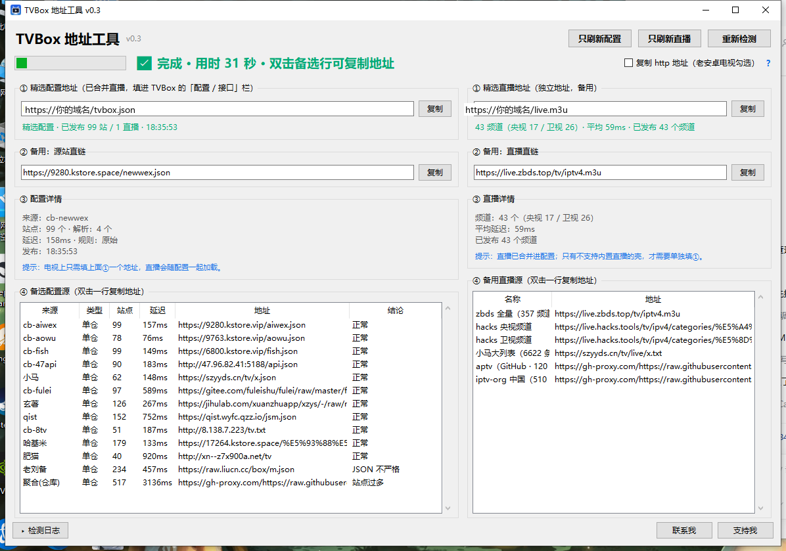

# TVBox 地址工具

**一键体检 TVBox 配置接口和直播源，只给你一个能用的地址。**

不用再一个个试接口，也不用担心电视上的地址过几天就失效。

如果不会操作，可以直接将仓库地址丢给你的AI让它告诉你怎么操作



---

## 这个工具解决什么问题

TVBox（影视仓、各种 TVBox 壳）都要填一个「配置地址 / 接口」。这个地址背后的站会换域名、会挂、会删分类，
所以过几天就打不开了，只能再去群里翻一个新的。

这个工具做四件事：

1. **体检配置源**：一次测十几个公开配置源，挑出当前最快、站点最多的那个，给你一个能用的地址
2. **整理直播源**：从多个公开直播列表里挑出央视、卫视、体育台，逐条测速、验编码、控码率
3. **给出地址**：左边点一下复制就能填进 TVBox，不用自己一个个试
4. **一键刷新**：源站挂了，点一下「检测全部」重新挑；另外配套一份 Cloudflare Worker 源码，
   可以把配置和直播合并成一个**永远不变**的地址（电视只填一次）

> 不接自建服务器也能完整使用：左边给的是公共源里最好的那个地址，挂了就再点一次重新挑。

## 下载

到本仓库的 **Releases** 页面下载 `TVBox地址工具-分享版.zip`，解压后双击 `TVBox地址工具.exe`。

- 免安装，不需要 Python
- Windows 10 / 11（64 位；打包用的是 Python 3.12，Win7/8 跑不了）
- 没有数字签名，首次运行会有 SmartScreen 提示，点「更多信息 → 仍要运行」

> 别只把 exe 单独拖出来：旁边的 `_internal` 文件夹是程序的一部分，缺了打不开。

## 三步用起来

1. 双击 `TVBox地址工具.exe`，等 10~30 秒（顶部状态条会显示进度）
2. 左边「① 精选配置地址」→ 点「复制」
3. 填进 TVBox 的「配置 / 接口 / 订阅」栏，回桌面再进一次

> **老安卓电视（4.4 及更早）**：先勾右上角「复制 http 地址（老安卓电视勾选）」再复制。
> 老系统不认新版 HTTPS 证书，必须用 `http://`。

## 界面

| 位置 | 内容 | 怎么用 |
|---|---|---|
| 左 ① | 精选配置地址（体检后选出的最好那个） | **点「复制」，填进 TVBox** |
| 左 ② | 备用：源站直链 | 固定地址打不开时临时用 |
| 左 ③ | 配置详情 | 站点数、解析数、延迟、发布时间 |
| 左 ④ | 备选配置源 | **双击一行**复制该源地址 |
| 右 ① | 精选直播地址 | 配置源自带的直播不满意时填这个 |
| 右 ② | 备用：直播直链 | 精选直播挂了时临时用 |
| 右 ③ | 直播详情 | 频道数、央视/卫视数量、平均延迟 |
| 右 ④ | 备用直播源 | 几个现成直播列表，双击一行复制 |
| 底部 | 检测日志 | 默认折叠，点「▸ 检测日志」展开 |
| 顶部 | 源接口工具 | 从多个接口发布页采集可用单仓（进阶） |

> 上图是早期版本截图，地址是示例；新版在这种两栏布局上加上了「检测全部」按钮和「站长工具」。

## 三个按钮

| 按钮 | 耗时 | 做什么 |
|---|---|---|
| 只刷新配置 | 约 10 秒 | 只动左栏：重测配置源、刷新地址，右边直播完全不动 |
| 只刷新直播 | 约 20 秒 | 只动右栏：重建直播列表，左边配置完全不动 |
| 检测全部 | 约 30 秒 | 配置源 + 直播一起全量检测，两栏一起刷新 |

## 直播整理规则

工具不是「能用的都塞进去」，而是有取舍的：

| 项目 | 规则 |
|---|---|
| 央视 | CCTV-1 ~ CCTV-17 全保留，按编号排序；超过 300ms 也保留（宁慢不缺） |
| 卫视 | 固定 24 个（不含青海 / 内蒙古 / 西藏），按清晰度从高到低排序，一个都不能少 |
| 体育 | 只收 300ms 以内的，最多 6 个 |
| 编码 | 只要 H.264 / H.265（H.264 优先）；AVS、纯音频线路直接排除 |
| 清晰度 | 央视：1080p 且 ≤4.5Mbps 优先；卫视：1080p ≤4.5M → 1080p 4.5~11M → 540p 以上 ≤3M |
| 测速 | 并发实测，慢的频道自动复测最多 3 轮 |

之所以卡编码和码率，是因为很多电视盒子（尤其老安卓）放不动高码率 H.265，或者碰上 AVS 编码只有声音没有画面。

## 站点名自动编号

配置里的站点名会自动改成 `1 旺仔|暴风资源`、`2 旺仔|百度采集`…… 的格式，方便在电视上按数字快速选。
最多 **9 个站**，因为站点越多电视加载越慢。

> `旺仔|` 只是站名前缀，在配置里随手改就行（编号是程序自动加的）。

## 分类整理（可选，需要自建服务器）

有些配置源会带敏感分类。配套的 Cloudflare Worker 可以做一层代理：
**删掉敏感分类，只保留内容最多的那一个改名「学习」放到最后**，搜索和播放都不受影响。

这一步需要自己部署一个 Worker（免费），步骤见 [自建服务器](docs/自建服务器.md)。
不部署也完全能正常用，只是没有这层过滤。

## 目录结构

```
github分享/
├── README.md
├── LICENSE                     MIT
├── CHANGELOG.md                更新记录
├── src/                        工具源码（Python 3，纯标准库）
│   ├── tvbox_finder.py         主程序：GUI + 体检 + 发布
│   ├── share_entry.py          分享版入口（关掉站长发布功能）
│   ├── source_finder.py        源接口工具
│   ├── merge_warehouse.py      多仓合并
│   ├── patrol.py               站长工具（一键巡检）
│   ├── owner_auth.py           站长密码
│   ├── sources.json            配置源列表
│   ├── 启动检测.bat             源码方式启动
│   ├── version_tool.txt        exe 版本信息
│   └── 数据/source_index.json   源接口工具的采集入口
├── worker/                     Cloudflare Worker（可选，自建服务器用）
│   ├── worker.js
│   └── wrangler.toml
├── examples/                   模板，复制成正式文件再改
│   ├── cloud.example.json      上传配置模板
│   ├── custom_config.example.json  自定义单仓模板
│   ├── class_rules.example.json    分类改写规则模板
│   └── sources.example.json   配置源列表示例
├── docs/                       文档
└── assets/                     图标
```

## 用源码跑

需要 Python 3.9 以上，**不需要装任何第三方库**。

```powershell
cd src
python tvbox_finder.py
```

想直接双击启动，用 `src/启动检测.bat`。

`src/sources.json` 是配置源列表，加一行就行：

```json
{"name": "我自己的源", "url": "https://example.com/api.json"}
```

## 自己打包 exe

见 [打包说明](docs/打包说明.md)。要点：**必须用 `--onedir`**，不要用 `--onefile`。

## 自建服务器（可选）

把「一个固定地址」这件事做到极致：配置和直播都存在 Cloudflare 的 KV 里，电视永远只填同一个地址。
免费额度足够个人用，附完整 Worker 源码，见 [自建服务器](docs/自建服务器.md)。

## 更多文档

- [使用说明（详细版）](docs/使用说明.md)
- [自建服务器](docs/自建服务器.md)
- [原理：它是怎么测的](docs/原理说明.md)
- [常见问题](docs/常见问题.md)
- [打包说明](docs/打包说明.md)

## 免责声明

本工具只做配置地址与直播源的体检整理，**不提供、不存储任何影片资源**；
片源内容均由第三方公开来源提供，请自行判断使用是否合规，风险自负。

## 支持
如果觉得不错，可以支持一杯奶茶，十分感谢，我会继续完善这个项目
(docs/images/zanzhu.png)
## 许可

[MIT](LICENSE)
